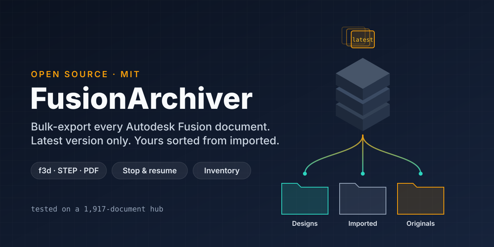

# FusionArchiver



[](https://github.com/marshallguillory86/fusion-archiver/actions/workflows/ci.yml)

Bulk-export **every document in your Autodesk Fusion hub** to local files, **latest version only**, with your own designs sorted apart from the models you imported.

Fusion has no built-in "export everything." If your subscription is ending, you're moving to another CAD package, or you just want a real offline backup, the only native option is opening and exporting files one at a time. Some existing scripts open **every version** of every design and export each one, which can turn a few hundred designs into a multi-day job. FusionArchiver opens each document once.

> **Status: beta.** Used to archive a real hub of 1,917 documents: 1,647 models exported, 115 non-Fusion files downloaded, and 8 files that Fusion itself would not open or export flagged for manual handling. The core logic is covered by automated tests in CI. The Fusion side is tested against a stub of the Fusion API. Please [open an issue](../../issues) if something fails on your hub.

## Known limitations
- **Drawings are slow.** In testing, a single drawing PDF took 15–25 minutes, while models take seconds each. Use *Defer drawings* to get every model out first.
- **Fusion sometimes reports a failed export that actually worked.** On some large assemblies, `execute()` returns False even though it wrote a valid file. FusionArchiver keeps the file and notes it in the log. Large archives use Zstandard compression, which Python's `zipfile` can't read before 3.14. That doesn't mean the file is corrupt.
- **Fusion drawing templates** can't be downloaded through the API ("file type not available for download").
- **Classification is a heuristic.** Review `Imported/` and adjust it with the *Always mine* / *Always imported* settings.

## What it does

| Document | Output | Folder |
|---|---|---|
| Your designs (`.f3d`) | Formats you choose: Fusion archive (`.f3d`), STEP, IGES, SAT, SMT, STL, 3MF | `Designs/<project>/<folders>/` |
| Imported models | Same formats | `Imported/<project>/<folders>/` (optional) |
| Drawings (`.f2d`) | PDF | `Designs/<project>/<folders>/` |
| Non-Fusion files (DXF, PDF, CAM/Nest templates, …) | Downloaded as-is | `Originals/<project>/<folders>/` (optional) |

- **Latest version only.** One open per document.
- **Stop and resume.** Press **Stop** whenever you want. Run again with the same output folder and finished documents are skipped. Failed or partial exports are retried, and a document with a new version gets exported again.
- **Inventory.** `inventory.csv` lists every document with the outputs written, any errors, and the evidence used to classify it.
- **Never overwrites.** If two documents in the same folder have the same name, the second gets a short ID suffix.

## Install

1. Download the [latest release](../../releases) (or clone this repo).
2. In Fusion: **Utilities → Scripts and Add-Ins** (Shift+S) → **Scripts** tab → **+** → select the `FusionArchiver` folder.
3. Select **FusionArchiver** → **Run**.

## The settings dialog

| Setting | Default | Notes |
|---|---|---|
| Output folder | — | Required. Use the same folder every time so runs can resume. |
| Formats | Fusion archive + STEP + Drawings to PDF | Choose at least one. Mesh formats (STL/3MF) export visible bodies. |
| Defer drawings | Off | Drawing export can be much slower than model export. Turn this on to export every model first, then run again with it off to do the drawings. |
| Separate Imported folder | On | Off = everything goes under `Designs/`. Classification is still recorded in the inventory. |
| Always mine / Always imported | empty | Name patterns separated by `;`, with `*` wildcards, e.g. `bracket_*; hull_v*`. Overrides the automatic classification. |
| Download non-Fusion files | On | Downloads uploaded files that Fusion can't convert, unchanged. |
| Skip projects | empty | Exact project names separated by `;`. |

Settings are saved to `settings.json` next to the script.

## How "imported" is decided

Checked in this order. The first rule that matches wins:

1. Name matches **Always mine** → design
2. Name matches **Always imported** → imported
3. Uploaded as a foreign format (`.step`, `.stl`, `.sldprt`, `.ipt`, …) → imported
4. Has at least one sketch → design
5. Only mesh bodies → imported
6. Direct-modeling design, empty timeline, or a timeline made only of base features → imported
7. Otherwise → design

These are heuristics. A design you drew in direct-modeling mode with no sketches will land in `Imported/`. Check `inventory.csv` (the `reason` column), add patterns, and re-run. Already-exported files are not moved automatically.

## Output folder contents

```
<output>/
  Designs/<project>/<folders>/<name>.f3d | .step | .pdf ...
  Imported/<project>/<folders>/<name>.f3d | .step ...
  Originals/<project>/<folders>/<name>.dxf | .pdf ...
  inventory.csv        one row per document (appended each run)
  state.json           resume state, keyed by document id + version
  log_<timestamp>.txt  one per run, includes settings and drawing timings
```

Delete `state.json` to force a full re-export.

## Development

The Fusion API (`adsk`) only exists inside Fusion, so the logic lives in `archiver_core.py`, which is plain Python, and `FusionArchiver.py` is a thin adapter.

```bash
python -m pip install pytest pytest-cov ruff bandit
python -m pytest -q --cov=archiver_core     # unit, acceptance (Given/When/Then) and adapter-stub tests
ruff check .
bandit -q -r FusionArchiver
```

CI runs all of the above on Linux, macOS and Windows with Python 3.10 and 3.12.

## License

[MIT](LICENSE). Autodesk and Fusion are trademarks of Autodesk, Inc. This project is not affiliated with or endorsed by Autodesk.
